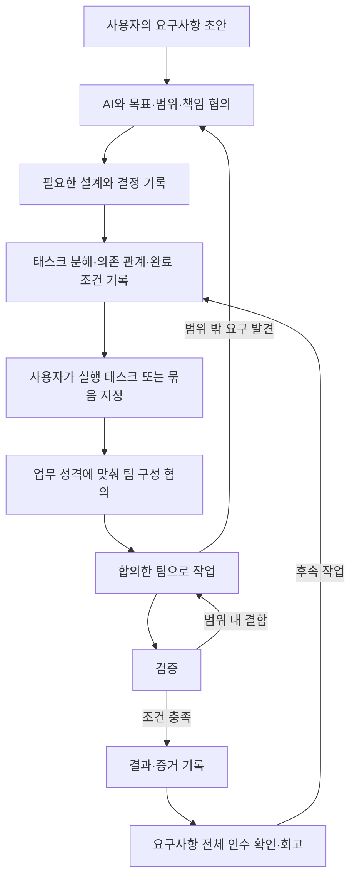

# 요구사항 협의와 태스크 중심 에이전트 협업

## 프로세스 설명

사용자가 요구사항을 먼저 정리하고 AI와 논의해 목표와 업무 범위를 구체화한다. 팀별 업무 성격을 바탕으로 구성 상담자와 필요한 역량·후보·책임을 의논해 이번 팀을 정한다. 합의한 내용을 검증 가능한 태스크로 나누어 기록한 뒤, 사용자가 선택한 태스크를 에이전트 팀에 배정한다. 팀은 정해진 범위 안에서 구현과 검증을 수행하고, 결과와 회고를 다음 작업에 활용한다.

이 문서에서는 이를 **요구사항 협의 → 태스크 중심 실행** 프로세스라고 부른다. 특정 제품의 내장 기능 이름은 아니다. 문서와 역할 지침으로 운용하는 작업 방식이다.



## 책임과 판단

| 주체 | 책임 |
| --- | --- |
| 사용자 | 문제의 의미, 우선순위, 포함·제외 범위, 제품 선택과 실행할 태스크 결정 |
| Mosaic | 업무 성격·필요 역량·후보·모델·effort를 사용자와 의논하고 구성 기록으로 인계 |
| 실행 리드 | 합의한 구성을 바탕으로 태스크 배정·실행 조율·결과 통합. 후보로 Compass를 사용할 수 있으며 리드도 협의에서 결정 |
| 설계 담당 | 구현 선택지와 영향 분석, 계약·실패 조건·검증 가능성 구체화 |
| 구현 담당 | 배정된 태스크와 파일 범위 안에서 구현하고 실행 근거 제공 |
| 검증 담당 | 완료 조건과 변경 영향을 독립적으로 확인하고 결함·미확인을 구분 |

사용자에게 이미 받은 실행 권한은 유지한다. 태스크 안에서 필요한 구현·테스트·수정마다 재확인을 요청하지 않는다. 반대로 태스크 목록을 만들었다는 이유만으로 목록 전체를 실행하지 않는다. “T-001만 실행”과 “T-001부터 T-004까지 의존 순서대로 실행”을 구분한다. 실행 중 생긴 범위 내 하위 작업은 리드가 관리하고, 새로운 제품 요구는 별도 태스크 후보로 기록한다.

## 단계별 운영

| 단계 | 입력 | 수행 내용 | 산출물·다음 단계 조건 |
| --- | --- | --- | --- |
| 1. 요구사항 초안 | 사용자 메모, 문제, 사례 | 원래 요청을 보존하고 사실·해석·가정을 분리 | 요구사항 기록, 목표와 미결 질문 |
| 2. 범위·책임 협의 | 초안, 기존 시스템 | 사용자 흐름, 포함·제외 범위, 우선순위, 역할 책임 논의 | 수용 기준과 결정 기록. 작업을 막는 제품 선택은 사용자가 결정 |
| 3. 필요한 설계 | 범위와 제약 | 변경 경계, 공개 계약, 실패·복구, 검증 방법 확인 | 태스크 분해에 충분한 설계. 작은 변경은 요구사항 문서 안에 짧게 기록 |
| 4. 태스크 분해 | 설계와 수용 기준 | 검증 가능한 단위로 분리, 의존 관계·소유권·팀 배정 | 작업 계획과 Ready 태스크. 미확정 사안은 조사 태스크로 분리 |
| 5. 태스크 실행 | 사용자가 지정한 Ready 태스크와 합의한 구성 | 관련 지침과 최신 코드를 읽고 업무 배정 | 변경과 구현 검증. 범위 밖 문제는 별도 기록 |
| 6. 검증·완료 | 최종 변경 상태와 완료 조건 | 담당자가 검증, 결함 수정·재검증 | 조건별 증거와 Done 판정. 미검증은 통과로 처리하지 않음 |
| 7. 전체 인수·회고 | 관련 태스크 결과 | 사용자 목표와 통합 흐름 확인, 반복 실패·개선점 기록 | 요구사항 충족 여부, 후속 태스크, 지침 개선안 |

태스크 완료와 배포·공개·merge는 별개의 작업이다. 사용자가 해당 작업까지 지정했는지 따른다. 모든 태스크가 Done이어도 최종 사용자 흐름이 확인되지 않았다면 요구사항 전체가 충족됐다고 단정하지 않는다.

## 업무 프로필·역할 후보·실제 팀 구성을 분리하기

- **업무 프로필:** 팀이 해결할 문제, 필요한 관점, 산출물과 완료 기준. 특정 에이전트를 포함하지 않는다.
- **역할 목록:** 구성·설계·구현·검증·조사·지식 관리 분야의 16개 역할을 후보로 제공한다. 원본은 agents/의 분야별 폴더에서 관리하고 실행용 사본은 스크립트로 .codex/agents/(Codex)와 .claude/agents/(Claude Code)에 배치한다. Scout는 사전 조사, Harness는 테스트 기반 구축, Curator는 회고·규칙 정리가 필요할 때 선택한다.
- **팀 구성 기록:** 해당 프로젝트·태스크에서 사용자와 정한 실제 멤버, 담당 범위, 모델·effort, 순서와 검증 방식. [팀 구성 템플릿](templates/team-composition.md)을 사용한다.

| 단계·업무 프로필 | 필요한 관점 | 산출물 |
| --- | --- | --- |
| 요구사항 협의 `discovery` | 사용자 흐름, 우선순위, 단순성 | 범위·수용 기준·미결 질문 |
| 기술 설계 `design` | 구조, 계약, 실패·복구 | 설계 결정·변경 영향 |
| 태스크 계획 `planning` | 의존 관계, 코드 소유권, 검증 가능성 | 실행 가능한 태스크와 순서 |
| 태스크 실행 | 작업별 원인 분석·구현·통합·측정·검증 | 지정된 결과와 완료 증거 |
| 전체 인수 `acceptance` | 사용자 목표, 최종 통합, 회귀 | 요구사항별 결과·미확인 항목 |

### Mosaic와 구성 의논하기

1. 업무 목표와 범위를 공유한다. 아직 요구사항을 정리하는 단계라면 그 협의에 필요한 팀부터 논의할 수 있다.
2. Mosaic는 필요한 역량과 제약을 정리하고 역할 파일에서 후보를 비교한다. 이름이나 성격만으로 고르지 않는다.
3. 최소 구성안을 추천하고 필요하면 보강안을 비교한다. 역할 한 명이 여러 관점을 맡을 수 있으며 독립 검증 필요 여부도 의논한다.
4. 사용자와 구성·책임·모델·effort·실행 순서·수정 소유권을 정한다. 명시적으로 구성을 위임한 경우에는 그 범위에서 결정하고 기록한다.
5. 합의한 구성을 실행 리드에게 넘긴다. Mosaic가 모든 실행에 상주하거나 또 다른 관리 계층이 될 필요는 없다.

메인이 Mosaic의 지침을 읽어 직접 상담할 수 있다. 상담 자체를 위해 서브에이전트를 생성할 필요는 없다. 실행 리드가 메인이라면 별도 리드를 중복 생성하지 않는다. 구성 합의와 실행 지시는 구분하되 이미 받은 권한은 재확인하지 않는다.

팀 이름만으로 멤버를 배정하지 않는다. 동일한 bugfix 업무여도 원인 불확실성, 변경 영향, 필요한 전문성에 따라 다른 구성을 정할 수 있다. 합의한 팀을 여러 태스크에 재사용할 수 있으며, 범위나 위험이 바뀌면 기존 위임 범위 안에서 조정하거나 사용자와 다시 의논한다.

이미 확정된 설계는 재사용하고, 현재 런타임의 동시 활동 한도를 따른다. 역할 파일의 모델·effort와 실제 실행 설정을 구분한다. 협의·설계·계획·인수 확인에서는 제품 코드를 수정하지 않고 배정된 문서·분석·검증을 수행한다.

## 태스크를 나누는 기준

좋은 태스크는 하나의 설명 가능한 결과와 독립적으로 확인할 완료 조건을 가진다. 파일 수나 코딩 시간만으로 분리하지 않는다.

- 새로운 세션에서도 요구사항·결정·관련 코드 경로를 읽으면 시작할 수 있다.
- 담당 역할, 수정 범위, 유지할 계약, 검증 방법이 명확하다.
- 같은 파일을 수정하는 태스크는 순차 배정하거나 소유권을 다시 나눈다.
- 선행 작업의 산출물이 필요하면 의존 관계를 명시한다. 서로 의존하면 계약 확정 태스크를 앞에 두거나 한 태스크로 합친다.
- 구현 방법이 핵심적으로 불명확하면 조사 태스크를 만든다. 산출물은 조사 결론과 근거이며 구현 완료를 약속하지 않는다.
- 구현 담당은 자신의 변경을 검증한다. 독립 검증 담당을 둬도 구현 검증을 생략하지 않는다.
- 모든 작은 변경을 별도의 설계·코딩·테스트 태스크 세 개로 쪼개지 않는다. 한 태스크 안에 구현과 검증 단계를 둘 수 있다.

### Ready: 실행 준비 조건

목표·제외 범위·요구사항 연결·완료 조건·검증 방법·담당·수정 경계가 기록되어 있고, 시작을 막는 미결 선택이 없으며 선행 조건이 충족되어야 한다. Ready는 준비 상태이고 실행 허가 자체는 아니다. 이미 해당 태스크 또는 묶음의 실행을 지시받았다면 재승인 없이 진행한다.

### Done: 완료 조건

요구한 산출물이 존재하고 완료 조건별 검증 증거가 있으며, 해당 태스크의 차단 결함이 해결되어야 한다. 검증한 코드 상태와 최종 변경 상태가 일치해야 한다. 실행할 수 없는 필수 검증이 남으면 Done으로 표시하지 않고 제한과 필요한 다음 조치를 기록한다. 사용자가 요구사항을 변경했다면 결정 기록과 완료 조건도 함께 갱신한다.

## 상태와 재개

```text
Draft → Ready → In progress → In review → Done
                              ↑      |
                              └──────┘ 수정·재검증
진행 중 차단 발생 → Blocked → 차단 해소 후 이전 단계
사용자가 취소한 태스크 → Cancelled
```

Blocked에는 원인, 재개 조건, 다음 행동과 담당을 기록한다. 단순히 어렵거나 오래 걸린다는 이유로 차단 상태로 두지 않는다. 실행 도중 발견한 새 요구사항은 현재 태스크의 완료 조건에 조용히 추가하지 않는다.

새 세션에서는 현재 태스크, 관련 요구사항·결정, 선행 결과, 최신 코드 상태, 미해결 문제를 전달한다. 대화 전체를 기억한다고 가정하지 않는다. 역할 지침을 읽는 것과 실제 실행 모델·effort를 설정하는 것은 별도이므로 리드가 둘 다 확인한다.

## 기록 위치와 템플릿

이 공개 playbook에는 재사용할 프로세스와 템플릿을 둔다. 실제 프로젝트 요구사항·고객 정보·코드 실행 기록은 대상 프로젝트의 기존 문서나 이슈 시스템에 둔다. 기존 이슈 트래커가 있으면 그것을 기준 기록으로 사용하고 Markdown에 같은 상태를 중복 관리하지 않는다.

별도 체계가 없는 프로젝트에서의 예시:

```text
docs/work/
  REQ-001/requirements.md
  REQ-001/plan.md
  REQ-001/team.md
  REQ-001/tasks/T-001.md
  REQ-001/tasks/T-002.md
  REQ-001/retrospective.md
```

| 템플릿 | 용도 |
| --- | --- |
| [요구사항](templates/requirements.md) | 사용자 초안, 수용 기준, 범위와 결정 |
| [팀 구성](templates/team-composition.md) | 업무별 후보 비교, 합의한 멤버·모델·책임·협업 조건 |
| [작업 계획](templates/work-plan.md) | 태스크 목록, 의존 관계, 책임, 요구사항 대응 |
| [태스크](templates/task.md) | 배정, 실행 상태, 모델·effort, 완료 증거 |
| [회고](templates/retrospective.md) | 실제 관찰, 원인, 개선 실험과 반영 범위 |

작은 작업은 한 문서에 필수 항목을 합쳐도 된다. 모든 템플릿을 채우기 위한 문서를 만들지 않는다.

## 예시: 사용자 알림 설정

사용자 초안: “알림을 켜고 끌 수 있고 다음 로그인에도 유지됐으면 한다.”

협의할 사항: 알림 종류별 설정인지 전체 설정인지, 기존 사용자 기본값, 다른 기기와의 동기화, 저장 실패 시 표시. 이 선택을 AI가 임의로 확정하지 않는다. 아래 분해는 예시를 위해 “전체 알림 on/off, 기본값 on, 계정 단위 저장, 실패 시 기존 상태 유지”로 합의했다고 가정한다.

| 태스크 | 결과 | 선행 조건 | 업무 프로필 | 완료 증거 |
| --- | --- | --- | --- | --- |
| T-001 | 계정별 설정 저장·조회/변경 API | 기본값·권한·API 계약 합의 | integration | 소유권, 기본값, 저장·재조회·실패 경로 검증 |
| T-002 | 설정 화면과 API 연결 | T-001 완료 | feature | 변경·새 로그인·저장 실패 상태 검증 |
| T-003 | 최종 통합 인수 확인 | T-001, T-002 완료 | acceptance | 사용자 흐름과 기존 알림 기능의 회귀 결과 |

위 프로필은 업무 유형만 지정하며 멤버는 팀 구성 상담에서 정한다. 이 세 태스크는 실행 순서 예시다. 실제 코드 규모가 작다면 T-001과 T-002를 하나로 묶을 수 있다. 사용자가 T-001만 지시했다면 T-002까지 자동 실행하지 않는다. 전체 실행을 지시했다면 의존 조건을 충족할 때마다 다음 태스크로 진행한다.

## 바로 사용할 요청

요구사항 협의:

```text
<playbook 경로>/WORKFLOW.md와 agents/coordination/mosaic.toml을 읽고 구성 상담을 해줘.
다음은 내가 정리한 요구사항이야: …
discovery 업무에 필요한 관점과 후보를 제안하고 나와 팀 구성을 의논해줘.
이번에는 요구사항과 역할 범위까지만 정하고 코드는 수정하지 마.
```

태스크 계획:

```text
합의한 <요구사항 경로>와 <결정 기록>을 바탕으로 planning 업무에 맞는 팀을 의논해줘.
태스크별 수정 범위·의존 관계·프리셋·완료 조건·검증 방법을 기록해줘.
구현은 아직 시작하지 마.
```

태스크 실행:

```text
<playbook 경로>/WORKFLOW.md와 역할 파일을 읽어줘.
대상 프로젝트: …
태스크: <T-001 문서 또는 이슈 링크>
<팀 구성 기록>에 합의한 구성과 지정된 업무 프로필로 이 태스크만 구현·검증하고 결과를 기록해줘.
범위 내 결함은 수정 후 재검증하고, 새 요구사항은 후속 후보로 남겨줘.
```

## 서베이에서 채택한 것과 채택하지 않은 것

아래는 사례를 참고한 우리 프로세스 설계 판단이며, 해당 프로젝트를 설치하거나 성능을 재현했다는 의미가 아니다.

| 참고 자료 | 채택한 원칙 | 우리 방식에 맞춘 조정 |
| --- | --- | --- |
| [BMAD](https://github.com/bmad-code-org/BMAD-METHOD) | 요구사항·설계 결정을 다음 단계로 전달하고 작업 규모에 맞게 절차 조절 | 전체 프레임워크 도입 대신 협의·계획·실행 문서 연결 |
| [Agency Agents](https://github.com/msitarzewski/agency-agents) | 역할별 산출물과 시나리오별 참여 구성 | 기존 역할을 후보로 유지하고 업무마다 구성을 의논 |
| [VoltAgent Codex Subagents](https://github.com/VoltAgent/awesome-codex-subagents) | 전문 역할별 점검 기준과 근거 중심 보고 | 외부 프롬프트를 그대로 복사하지 않고 기존 역할과 연결 |
| [Anthropic Research](https://www.anthropic.com/research/multi-agent-research-system) | 명시적 목표·출력·작업 경계로 중복 감소 | 태스크 템플릿에 배정 계약 기록 |
| [Cursor](https://cursor.com/blog/scaling-agents) | 계획·실행·판정 책임 분리 | 사용자 선택을 유지하고 Compass가 모든 구현의 병목이 되지 않도록 함 |
| [Anthropic 컴파일러 실험](https://www.anthropic.com/research/building-c-compiler) | 테스트·작업 격리·간결한 진행 기록 | 무한 실행 루프 대신 선택된 태스크 범위에서 완료 판정 |
| [Slite](https://langfuse.com/users/slite) | 기록과 평가 사례를 이용해 변경 효과 확인 | 회고 → 변경 제안 → 대표 태스크 비교 절차 |

상세 운영·모니터링 사례는 [조사 문서](research/2026-11-06-agent-teams-and-observability.md)를 참고한다. 초기에는 문서와 Git으로 운용한다. 실행량이 늘면 공통 task/run ID로 추적 도구를 연결하되 설치·연동은 별도 작업으로 진행한다.

## 프로세스 개선 지표

첫 검증 통과율, 재작업 횟수, 작업 시간, 범위 변경 원인, 도구 실패, 미검증 항목을 기록한다. 모델·역할 지침·프리셋 버전을 함께 남긴다. 토큰·비용이 제공되지 않으면 미수집으로 표시한다. 역할이나 팀의 변경은 비슷한 난도의 대표 태스크로 비교하고, 한 번의 성공·실패만으로 영구 규칙을 추가하지 않는다.
